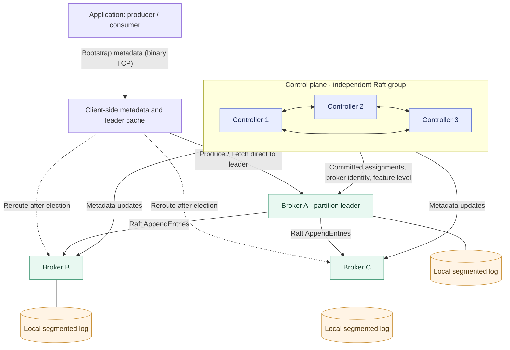
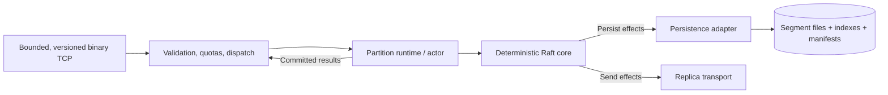
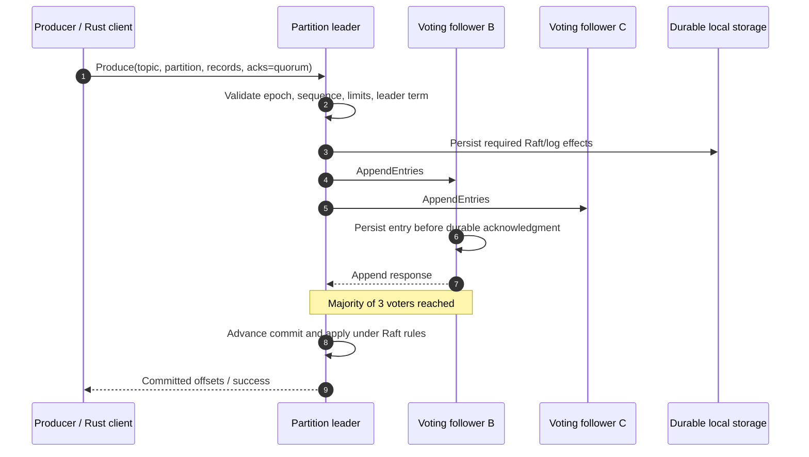
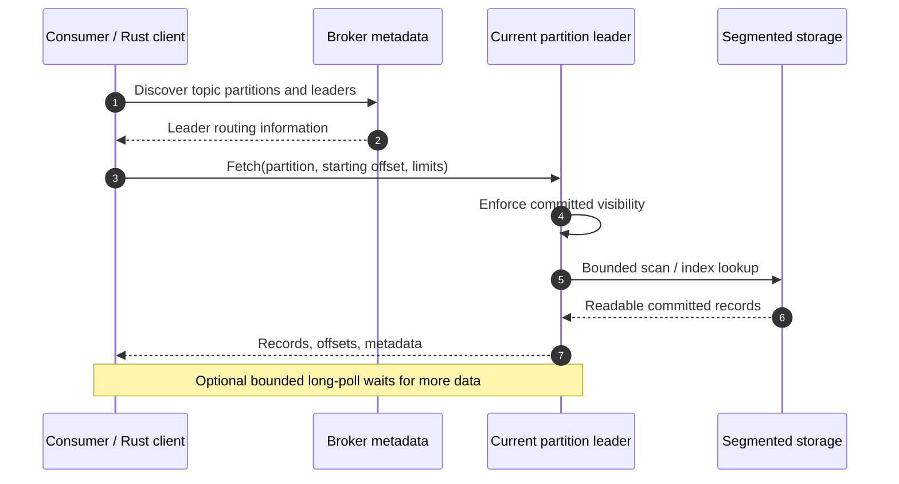
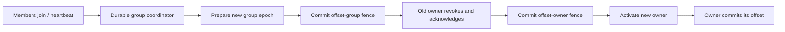
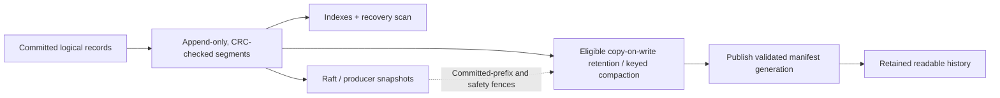

# AstraLog

### A distributed event log, built from first principles in Rust

**AstraLog** is a Kafka-inspired, fault-tolerant event-streaming engine built to explore the systems problems behind a message broker: durable storage, distributed consensus, leader election, client retries, ordered consumption, rebalancing, and crash recovery.

Applications publish records to **topics**. Topics are split into **partitions**. Each partition owns an ordered log and, when replicated, an independent **Raft consensus group**. A separate controller Raft group owns cluster metadata rather than sitting on the hot data path.

> **Project status:** Working, tested **local engineering/portfolio prototype**, not a production-ready Kafka replacement. Broker networking currently permits **loopback-only** connections and does not implement client TLS, authentication, or authorization. P9 retention work has an unqualified P9-G boundary; P10 queues and full P11/P12 production operations are not finished. See [current state](docs/CURRENT_STATE.md) and [security scope](SECURITY.md).

[](https://github.com/Thiyaga1586/AstraLog/actions/workflows/ci.yml)
[](LICENSE)

**Jump to:** [Architecture](#system-architecture) · [Write path](#1-producing-a-record) · [Read path](#2-reading-committed-data) · [Failure recovery](#what-happens-when-things-fail) · [Stack](#technology-stack) · [Run locally](#run-it-on-your-laptop) · [Roadmap](#limitations-and-future-work)

---

## Why build AstraLog?

Imagine an online store publishing an `OrderCreated` event. The payments, inventory, and analytics services need to process that event independently. They should be able to resume from a remembered position and should not lose a **committed** event just because a broker process stops.

AstraLog implements the key machinery itself instead of running Kafka, Pulsar, ZooKeeper, etcd, or an external storage service behind a custom UI.

| Concept | What it means here |
| --- | --- |
| **Producer** | An application sending records into the log |
| **Topic** | A named event stream, for example `orders` |
| **Partition** | One ordered lane within a topic; ordering is **per partition**, not global |
| **Leader / follower** | A partition's current Raft leader accepts writes; voting followers replicate its log |
| **Quorum** | A majority of voters; for three voting replicas, **2 of 3** |
| **Controller** | The separate consensus-backed authority for broker identities, topics, placement, feature levels, and movement intent |
| **Consumer offset** | A bookmark indicating progress through a partition |
| **Producer ID, epoch, sequence** | The identity and ordering information used for supported idempotent retries |

## System architecture

AstraLog deliberately separates **control plane** decisions ("which brokers and partitions exist?") from **data plane** traffic ("append this record; fetch committed records").



**The important distinction:** The controller commits *which replicas should host a partition*. It does not arbitrarily appoint the live leader. The **partition's own Raft group** elects its leader. Every partition can have a different leader, term, and failure domain. The three-broker picture above illustrates **one** RF3 partition; other partitions have independent Raft logs.

AstraLog uses **broker-local disks**. There is no separate storage-cluster dependency and no mandatory proxy in front of every request.

### What happens inside a broker?



- **Protocol layer:** Length-prefixed framed requests, checked sizes, correlation IDs, API versions, and bounded parsing.
- **Consensus layer:** A deterministic Raft engine emits effects such as *persist*, *send*, and *apply*. It is not the disk or network implementation.
- **Persistence layer:** Carries out durable effects, maintains checksummed segmented log files, and reconstructs state after restart.
- **Runtime layer:** Connects network requests to partition actors and coordinates backpressure, replication, acknowledgments, and recovery.

### The design choices, not just the feature list

| Decision | Why it matters | Trade-off |
| --- | --- | --- |
| **Raft per partition** | Independent order and independent leader failover | Many consensus groups need bounded scheduling and transport |
| **Separate metadata Raft** | Metadata has one durable authority without requiring controller consensus on every read/write | Another quorum to operate and recover |
| **Direct client-to-leader routing** | Avoids a mandatory forwarding hop on each request | Clients must refresh stale routes |
| **Custom binary TCP** | Makes framing, compatibility, limits, and ambiguous network outcomes visible | No built-in gRPC/HTTP security ecosystem |
| **Local segmented storage** | Direct control of disk, CRC checks, indexes, retention, and replay | Host filesystem durability needs careful qualification |
| **Fail closed on uncertainty** | A failed disk write or missing quorum does not become a fabricated success | Some operations reject or pause rather than remain available |

## How data flows

### 1. Producing a record

For a typical **`acks=quorum`** write, the client discovers the partition leader, the leader proposes the record, followers persist the replicated entry, and a Raft majority authorizes commit. Only then does a quorum-acknowledged write return success.



**Acknowledgment is an explicit contract, not an all-or-nothing claim:**

| Mode | What it means | Failure caveat |
| --- | --- | --- |
| `acks=0` | No response required | No delivery or durability promise |
| `acks=leader` | Leader-local durable acceptance | An uncommitted record can be lost after leader failure |
| `acks=quorum` | Raft majority-committed record | Preserved across legal minority failures, assuming the storage durability model holds |

Clients choose a partition by stable key hashing (or sticky behavior for eligible unkeyed batches), cache broker metadata, and can refresh routing after a leader change. Supported producer V1 retries keep the **same producer identity, epoch, sequence, and encoded request** so a lost acknowledgment does not cause a duplicate logical append within the retained deduplication contract.

### 2. Reading committed data



A follower may hold **durable but uncommitted** bytes; that is not permission to expose them in a normal committed Fetch. When a leader changes, uncommitted suffixes can be reconciled. Committed history remains the safety boundary. Logical stream offsets are **not the same as Raft indexes**, and retained-history compaction can leave gaps without renumbering records.

### 3. Consumer groups and offsets

Consumer groups distribute partition ownership across readers. AstraLog implements deterministic **uniform-sticky assignment** and cooperative transitions rather than blindly reassigning every partition at once.



The coordinator uses the current Raft leader for a shard of `__astralog_groups`; offsets live in separately replicated `__astralog_offsets` shards. **Group epoch and ownership fences** prevent stale owners from committing offsets after handoff. An ambiguous mutation such as a timed-out join is **not blindly retried**; it requires authoritative reconciliation. These semantics do **not** make arbitrary external database side effects exactly once.

### 4. Storage, snapshots, and retention



- **Recovery:** Scan bounded on-disk structures, reject invalid committed data, rebuild derived indexes, and restore Raft and producer state from durable evidence.
- **Compression and batching:** Client-side bounded accumulators; `none`, LZ4, or Zstandard on supported topic/storage paths; group commit and follower pipelining.
- **Retention:** Advance the readable log start and reclaim only eligible files.
- **Keyed compaction:** Build replacement segments **copy-on-write** and publish a validated manifest so interrupted work cannot expose a half-written file set. Original logical offsets remain stable.
- **Producer-state safety:** Historical data needed to reconstruct idempotent retry results cannot be reclaimed until the relevant committed producer checkpoint/snapshot gates permit it.

**Qualification boundary:** P9-G's coordinated cleaner-progress and retained-history V2 rebootstrap work is a **candidate, not yet fully qualified**. P9-H/I cleaner pressure and phase closure remain outstanding. See [P9-G evidence](docs/P9_G_CLOSURE_REPORT.md).

## What happens when things fail?

| Event | Expected response and correctness rule |
| --- | --- |
| **Partition leader crashes after quorum commit** | Remaining voters can elect a successor, preserve the committed prefix, and resume writes after establishing leader readiness. Clients rediscover the leader. |
| **Leader crashes with an uncommitted suffix** | New term can repair/truncate conflicting uncommitted entries; never pretend leader-only acceptance was quorum-committed. |
| **One voter isolated in RF3** | The remaining **two** can still make a majority. The isolated minority cannot independently commit. Losing two voters prevents new quorum writes. |
| **A Produce response is lost** | The outcome may be ambiguous. Idempotent V1 retries replay the exact identity/sequence/body and can return the original committed offsets; anonymous non-idempotent requests are not automatically safe to replay. |
| **Controller leader crashes** | Controller Raft elects a successor; committed placement and metadata survive. Already-authorized data traffic need not query the controller on every operation. |
| **Consumer coordinator fails** | A new group-shard leader replays committed membership, grants a fresh term-scoped session grace, and continues fence-driven reassignment rather than guessing ownership. |
| **Replica falls behind / rejoins** | Raft catch-up and authorized snapshot/rebootstrap paths restore eligible state. An obsolete snapshot cannot overwrite an already committed prefix. |
| **Network or queue overload** | Strict limits, reserved control capacity, quota-based rejection, and throttle signals prevent unbounded buffering; safety takes precedence over accepting more work. |
| **Corrupted durable bytes** | Checksums and consistency checks detect invalid state; the system must not silently rewrite committed history as healthy. |

**What this does not prove:** process-kill and controlled fault tests are not a physical power cut, sustained WAN partition test, disk-full chaos campaign, or formal proof of every deployed execution. On Windows, the filesystem directory-sync boundary is specifically **not** certified for sudden power-loss durability. See [engineering invariants](docs/INVARIANTS.md), [failure tests](docs/P5_FAILURE_REPORT.md), and [security notes](SECURITY.md).

## Technology stack

| Layer | Tools / libraries actually used | Where to look |
| --- | --- | --- |
| Core server | **Rust 2024**, pinned **Rust 1.98.1**, Tokio async runtime | [Broker](crates/astralog-broker/src), [toolchain](rust-toolchain.toml) |
| Consensus | Custom deterministic **Raft**, leader election, log replication, joint membership and snapshots | [Raft](crates/astralog-raft/src) |
| Durable log | Custom segmented WAL, CRC32C, indexes, manifests, copy-on-write compaction | [Storage](crates/astralog-storage/src) |
| Replication | Partition Raft runtimes, persistence effects, broker-to-broker transport | [Replication](crates/astralog-replication/src) |
| Cluster metadata | Independent controller Raft, placement, identity/epoch fencing, movement intent | [Controller](crates/astralog-controller/src) |
| Producer and reader SDK | Rust client, metadata caching, partition routing, batching, idempotent retry handling | [Client](crates/astralog-client/src) |
| Consumer groups | Durable group/offset state, cooperative rebalance and epoch fences | [Groups](crates/astralog-groups/src) |
| Wire protocol | Versioned length-prefixed binary TCP; explicit request/response codecs | [Protocol](crates/astralog-protocol/src) |
| Compression | **LZ4**, **Zstandard** and uncompressed records | [Storage codecs](crates/astralog-storage/src) |
| Control Center UI | **React**, TypeScript, Vite, Tailwind CSS, React Flow, Recharts | [Web app](dashboard/web), [Rust Axum adapter](crates/astralog-dashboard/src) |
| Engineering telemetry | Loopback **Prometheus** metric export, Docker Compose, **Grafana** dashboards | [Observability](observability), [guide](docs/MONITORING_MVP.md) |
| Validation | Cargo unit/integration tests, deterministic model tests, Rustfmt, Clippy, GitHub Actions, source-pinned benchmark harness | [CI](.github/workflows/ci.yml), [benchmarks](crates/astralog-benchmark/src) |

The core broker does **not** depend on Kafka, an external SQL database, Kubernetes, or a hosted messaging service. Grafana/Prometheus are an **optional local monitoring stack**, not the event storage engine.

## Run it on your laptop

### Prerequisites

- **Windows** for the provided `.cmd` launchers and PowerShell benchmarking scripts; **Git**, **Rust / Cargo** with `rustup` (toolchain pinned in the repository), **Node.js + npm**.
- **Docker Desktop** is optional, for Prometheus and Grafana only.
- Internet access for first-time Cargo/npm dependency installation. Later `--offline` benchmark runs require locally cached Rust crates.
- Free local ports for the demo: **7001–7003** (broker TCP), **7101–7103** (Raft peer TCP), **8787** (Axum adapter), and **5173** (web UI).

#### Step 1 — clone the code

```powershell
git clone https://github.com/Thiyaga1586/AstraLog.git
cd AstraLog
rustup show
```

#### Step 2 — run three real brokers and the visual Control Center

In **Windows Command Prompt (CMD)**, from the project root:

```bat
scripts\run-control-center.cmd
```

This opens three CMD windows: (1) the disposable RF3 broker demo with real test Produce/Fetch traffic, (2) a loopback-only read-only Rust/Axum metadata adapter, and (3) the React development server. The first build may be slow because Cargo and npm install dependencies. **This particular quickstart is a static-topology demo**; the separately implemented controller Raft quorum is exercised in dynamic-cluster integration tests, not started by this launcher.

**Open the Control Center:** http://127.0.0.1:5173

The UI offers an interactive broker topology and partition explorer. **Live** is based on real Metadata V0 returned by AstraLog. **Preview** is visibly labeled illustrative data; historical benchmark charts are never presented as current live throughput.

You can also run the three components manually using the exact commands in the [Control Center guide](docs/CONTROL_CENTER.md). Close the three CMD windows (or press Ctrl+C in each) to stop the disposable demo.

#### Step 3 — optional live Prometheus and authenticated Grafana

With Docker Desktop running **and the brokers already started**, run this in another CMD window from the repository root:

```bat
scripts\run-monitoring.cmd
```

| Service | Local address | Purpose |
| --- | --- | --- |
| Prometheus | http://127.0.0.1:9090/targets | Scrapes real broker `/metrics` endpoints |
| Grafana | http://127.0.0.1:3000 | Shows requests/s, acknowledged records/s, errors/s, and measured p50/p95/p99 server-side latency |
| Broker metrics | http://127.0.0.1:9201/metrics (also 9202/9203) | Each broker's counters and histograms |

Grafana **requires login** (username: `admin`). The launcher generates a strong, Git-ignored password, stored **only on your computer** at `observability\secrets\grafana_admin_password.txt`. To read it locally in CMD:

```bat
type observability\secrets\grafana_admin_password.txt
```

Anonymous access and self-signup are disabled. Grafana, Prometheus, and broker metrics bind to **127.0.0.1**, not the public internet. Do not publish these ports. See [monitoring details and metric semantics](docs/MONITORING_MVP.md); acknowledged responses per second are not identical to unique committed append throughput.

### Validate the project

Run from the repository root:

```powershell
cargo fmt --all -- --check
cargo clippy --workspace --all-targets --all-features --locked -- -D warnings
cargo test --workspace --all-features --locked -- --test-threads=1
```

For the frontend, run from `dashboard/web`:

```powershell
npm ci
npm run build
npm test
```

The same core checks run in [GitHub Actions](.github/workflows/ci.yml), including focused RF3 failover/regression gates and the full Rust workspace test suite. A green CI run is evidence for **that exact commit**, not a universal production-qualification certificate.

### Reproduce the producer/consumer benchmark

Run from repository root in **Windows PowerShell**:

```powershell
# Quick debug-mode functional smoke test (NOT a publishable performance result)
powershell -NoProfile -ExecutionPolicy Bypass -File scripts/run-interview-demo.ps1 -Fast

# Full optimized local benchmark + targeted failure checks
powershell -NoProfile -ExecutionPolicy Bypass -File scripts/run-interview-demo.ps1
```

The launcher creates a timestamped directory under your Windows TEMP folder containing **raw CSV samples, environment metadata, console logs, and derived summaries**. The integration tests use real loopback broker TCP endpoints, storage directories, record reads, and controlled fault scenarios. This is a **single-machine** test setup, not a three-machine cluster.

**Previously recorded example, not a new performance claim:** a historical RF3 quorum workload with 1 KiB records and four producers measured **10.71 records/s unbuffered versus 33.31 records/s buffered** in the post-audit comparison. These were short, two-repeat local measurements; hardware and raw results are in the [archived report](docs/benchmarks/remediation_20261103/SUMMARY.md).

**Benchmark provenance:** Historical CSVs and several old commit SHAs came from a prior private development lineage that is not reachable in this shortened public Git history. Do **not** describe those numbers as remeasured or exactly reproducible at the current public SHA. Rerun the benchmark at a reachable tagged commit and retain the new raw artifacts before making such a claim. See [demo methodology](docs/INTERVIEW_READY.md) and [benchmark harness](docs/P8_BENCHMARK_HARNESS_REPORT.md).

## Explore the codebase

| If you want to learn… | Start here |
| --- | --- |
| How one Produce request becomes a replicated entry | [Broker server](crates/astralog-broker/src/server.rs) → [Broker state](crates/astralog-broker/src/state.rs) → [Replication runtime](crates/astralog-replication/src/runtime.rs) |
| How election, commit, and persistence ordering work | [Raft engine](crates/astralog-raft/src/engine.rs) → [Persistence adapter](crates/astralog-replication/src/storage_adapter.rs) |
| How files survive a restart | [Storage partition log](crates/astralog-storage/src/partition.rs) → [Formats and recovery](docs/FORMAT_V1.md) |
| How topic placement and metadata fail over | [Controller runtime](crates/astralog-controller/src/runtime.rs) → [Placement](crates/astralog-controller/src/placement.rs) |
| How retries avoid duplicates | [Client](crates/astralog-client/src/lib.rs) → [Producer state](crates/astralog-replication/src/producer_state.rs) |
| How cooperative group ownership is fenced | [Groups](crates/astralog-groups/src) → [P6 design](docs/P6_GROUPS_V1.md) |
| How to assess correctness and design trade-offs | [Master engineering guide](docs/ASTRALOG_MASTER_GUIDE.md) → [Architecture decisions](docs/ARCHITECTURE_REVIEW.md) → [Invariants](docs/INVARIANTS.md) |

## Limitations and future work

The engineering roadmap is intentionally separate from what has already been demonstrated.

| Area | Current reality | Next milestone |
| --- | --- | --- |
| **P9 · Retention / rebootstrap** | Segmented V2 history and compaction machinery exist; **P9-G remains unqualified** | Exact-HEAD coordinated tombstone-safety/rebootstrap qualification, then P9-H/I cleaner stress and closure |
| **P10 · Work queues** | Not implemented; reserved designs and protocol surface are not an active queue service | Durable delivery leases, retries, poison-message handling, visibility timeout, and dead-letter queues |
| **P11 · Security and operations** | Local loopback demo, read-only Control Center, real monitoring MVP; **no broker/client auth or TLS** | Identity and authorization, secured transport, operational controls, alerting, rolling upgrades and full observability qualification |
| **P12 · Release qualification** | Deterministic models, selected process-kill/recovery tests, and bounded local benchmarks | Extended chaos and network-fault campaigns, disk/power-loss testing, compatibility/endurance runs and publicly source-pinned performance validation |

Other deliberate limits: no cross-partition total order or transactions; no exactly-once guarantee for arbitrary external side effects; no hosted multi-region or WAN deployment; no measured production SLO; local prototype endpoints must **never** be exposed to untrusted networks.

## Documentation and license

- [**Full architecture and interview guide**](docs/ASTRALOG_MASTER_GUIDE.md) — explanations, deep code walks, trade-offs, failure scenarios, and interview questions.
- [**Current implementation / qualification state**](docs/CURRENT_STATE.md) — granular progress and open gates.
- [**Runnable interview benchmark guide**](docs/INTERVIEW_READY.md) — methodology and raw-result provenance.
- [**Control Center setup**](docs/CONTROL_CENTER.md) and [**Grafana/Prometheus setup**](docs/MONITORING_MVP.md).
- [**Correctness invariants**](docs/INVARIANTS.md), [**system design decisions**](docs/DECISIONS.md), [**phase plan**](docs/PHASE_PLAN.md), and [**security disclosure**](SECURITY.md).

Licensed under [Apache License 2.0](LICENSE).

**AstraLog is an engineering exploration of how durable distributed logs work, why failures are ambiguous, and how to test the safety boundaries without claiming they are already production-qualified.**
