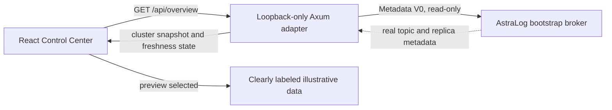

# AstraLog Control Center

## What this is

The Control Center is an interactive local observability UI for the AstraLog distributed event log. It has two explicit data modes:

- **Live** reads the real Metadata V0 response from a running AstraLog broker through a separate, read-only Rust HTTP adapter.
- **Preview** uses visibly labeled, illustrative sample metadata so the UI can be explored even without a running broker. Preview data is never presented as real cluster evidence.

The dashboard includes a React Flow broker and topic topology, registered-broker and partition counts, per-topic replica and leader assignments, an indexed partition browser, system architecture diagrams and a Recharts view of a prior source-pinned benchmark.

It does not display invented live throughput, error rate, broker heartbeats or latency. Metadata presence does not prove broker availability or follower health. This is a portfolio observability milestone, not P11 production observability qualification.

## Technology

| Component | Technology | Role |
| --- | --- | --- |
| Browser UI | React, TypeScript, Vite | Navigation, views, polling and data-source selection |
| Styling | Tailwind CSS and custom CSS | Responsive desktop and mobile experience |
| Topology | React Flow | Inspect topics and broker assignments |
| Charts | Recharts | Display measured historical benchmark results |
| Local adapter | Rust, Axum, Serde | Convert real AstraLog client metadata into read-only HTTP JSON |
| Demo brokers | AstraLog broker and Raft crates | Disposable local RF3 static cluster |

## Launch on Windows CMD

You need Rust 1.98.1 or the pinned toolchain, Node.js and npm installed. Run these commands in **three separate Command Prompt windows**. The first build may download crates and npm packages.

For a one-command launcher that opens the three CMD windows for you, run this from the project root:

```bat
scripts\run-control-center.cmd
```

The manual instructions below provide greater control over ports and startup order.

**CMD window 1. Start real RF3 brokers:**

```bat
cd /d D:\Workspace\AstraLog
cargo run -p astralog-broker --example control_center_demo -- --traffic
```

This demo starts three real static AstraLog brokers on `127.0.0.1:7001`, `7002` and `7003`, with independent P3 Raft groups for the `orders`, `payments` and `notifications` topics. Raft peer TCP listeners use ports `7101` through `7103`. It is an isolated, disposable sample cluster, not a production service. The broker example does not synthesize metadata responses. If ports conflict, use `-- --base-port 7401` and update the bootstrap port below.

The optional `--traffic` flag issues actual acknowledged Produce and committed
Fetch calls against this disposable demo cluster to make Prometheus rates
observable. It is synthetic **workload**, not fake telemetry. Omit `--traffic`
to see the cluster without generating records. The three brokers export real
metrics on loopback ports 9201, 9202 and 9203 with the default base port.

**CMD window 2. Start the Rust read-only adapter:**

```bat
cd /d D:\Workspace\AstraLog
cargo run -p astralog-dashboard -- --bootstrap 127.0.0.1:7001 --bind 127.0.0.1:8787 --poll-timeout-ms 5000
```

**CMD window 3. Start the React dashboard:**

```bat
cd /d D:\Workspace\AstraLog\dashboard\web
npm ci
npm run dev
```

Open `http://127.0.0.1:5173`. The UI polls `/api/overview` through the Vite development proxy to `http://127.0.0.1:8787`. After the adapter first obtains real metadata, the dashboard switches to **Live** automatically unless you explicitly selected a data mode.

To inspect the design without starting the brokers or adapter, run only the frontend and use the **Preview** toggle. That view is always labeled as illustrative.

Press `Ctrl+C` in each CMD window to stop the corresponding process. The RF3 example uses disposable temporary storage in the OS temporary directory. It does not modify existing AstraLog production data.

## Topology architecture



## API contract

The adapter serves only local HTTP GET endpoints:

| Endpoint | Result |
| --- | --- |
| `GET /api/overview` | JSON schema v1 with `adapter` and optional `cluster` |
| `GET /api/health` | Adapter process readiness and metadata connection state |

`adapter.state` has three meanings:

- `connected`: a real Metadata V0 poll succeeded.
- `disconnected`: no successful metadata snapshot has yet been collected.
- `unavailable`: polling failed after a prior success. The last snapshot is retained and clearly stale, with `last_success_at_ms`.

The `cluster` payload, when present, contains the cluster ID, metadata epoch, registered brokers, topic IDs, topic names, partition IDs, reported leader and leader epoch, and assigned replica broker IDs. Missing leader information is preserved as missing. No number is invented from the replica list.

The adapter has no CreateTopic, DeleteTopic, Produce, ReassignPartitions, admin or fault-injection route. It rejects non-loopback HTTP binds and non-loopback CORS origins. There is no authentication or TLS, so never forward these ports to an untrusted network.

## Benchmark provenance

The performance panels show **historical values**, not measurements collected from the current UI. Their source is [`docs/benchmarks/remediation_20261103/SUMMARY.md`](benchmarks/remediation_20261103/SUMMARY.md) and its paired raw CSV and sample artifacts.

The recorded RF3 quorum rates were 10.71 records/s unbuffered and 33.31 records/s buffered. Produce p95 was 480.50 ms unbuffered and 138.83 ms buffered. These are medians of only two short repeats on a single Windows laptop, with 1 KiB values and four concurrent producers. They are not a product SLA or a multi-machine deployment claim.

## Developer validation

From the canonical repo root:

```bat
cargo fmt --all -- --check
cargo test -p astralog-dashboard --locked
cargo clippy -p astralog-dashboard --all-targets --locked -- -D warnings
cargo build -p astralog-broker --example control_center_demo --locked
cd dashboard\web
npm ci
npm run build
npm test
```

The frontend production build is emitted under `dashboard/web/dist`, which is ignored by Git. The runtime frontend proxy is for local development; deploy neither the HTTP adapter nor the broker as a public web service without a separate authentication and security design.

## Boundary and future improvements

This first milestone deliberately avoids changing P0 through P9 consensus, storage, public broker protocol or failure semantics. Potential future independent work includes explicit broker liveness probes, a bounded metrics export contract, consumer group lag from authoritative committed state, time-series storage, authenticated operator actions, and P11 production observability qualification. Those capabilities are **not** implemented by this dashboard.
